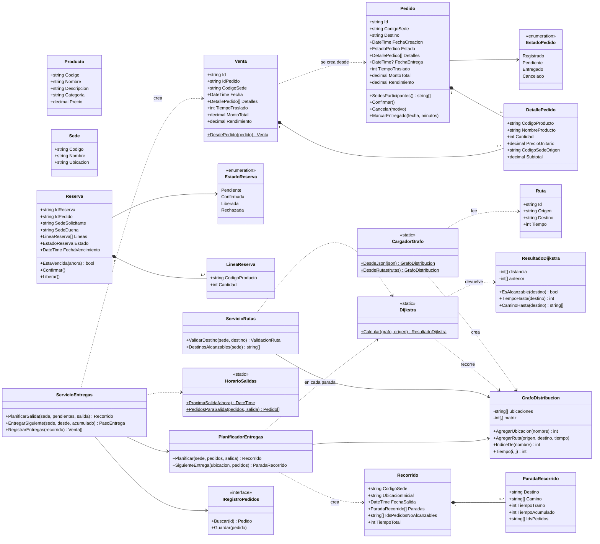

# ConviTEC: inventario distribuido y sistema de pedidos

Proyecto 2 de CE1103 Algoritmos y Estructuras de Datos 1, Instituto Tecnológico de Costa Rica.

ConviTEC simula una cadena de tiendas de conveniencia con cuatro sedes (Liberia, Alajuela, San José y Limón). Cada sede es una instancia independiente de la misma aplicación, con su API en C#, su frontend web y sus archivos locales. Las sedes se comunican por mensajes a través de RabbitMQ, y las entregas se planifican sobre un grafo de rutas con el algoritmo de Dijkstra.

## Requisitos

- .NET SDK 10 (comprobar con `dotnet --version`)
- Docker Desktop, para RabbitMQ
- VS Code con la extensión C# Dev Kit, o Visual Studio

## Estructura de la solución

```
ConviTEC.sln
docker-compose.yml        RabbitMQ
data/<SEDE>/              Archivos locales de cada sede (LIB, ALA, SJO, LIM)
src/
  ConviTEC.Core/          Lógica de negocio, estructuras de datos, algoritmos y grafo
  ConviTEC.Persistencia/  Lectura y escritura de los archivos de cada sede
  ConviTEC.Mensajeria/    Comunicación con RabbitMQ
  ConviTEC.Sede/          Programa de una sede: API REST + frontend (wwwroot)
tests/
  ConviTEC.Tests/         Pruebas unitarias (xUnit)
```

`Sede` depende de `Core`, `Persistencia` y `Mensajeria`; estos dos últimos dependen solo de `Core`.

## Cómo ejecutar

```bash
dotnet build                               # compilar todo
dotnet test                                # correr las pruebas
dotnet run --project src/ConviTEC.Sede     # levantar una sede
docker compose up -d                       # levantar RabbitMQ (con Docker Desktop abierto)
```

### Levantar una sede

Cada sede es la misma aplicación con otra configuración. Se elige con `--sede <CÓDIGO>` (también sirve la variable de entorno `CONVITEC_SEDE`):

```bash
dotnet run --project src/ConviTEC.Sede -- --sede LIB
```

| Código | Sede | Puerto | Archivos |
|---|---|---|---|
| `LIB` | Liberia | 5101 | `data/LIB/` |
| `ALA` | Alajuela | 5102 | `data/ALA/` |
| `SJO` | San José | 5103 | `data/SJO/` |
| `LIM` | Limón | 5104 | `data/LIM/` |

Al arrancar, la sede lee `appsettings.json` (RabbitMQ) y `appsettings.<CÓDIGO>.json` (código, nombre, puerto y carpeta de datos), y abre `http://localhost:<puerto>`. En Visual Studio hay un perfil de ejecución por sede (LIB, ALA, SJO, LIM). Se pueden levantar las cuatro a la vez en la misma computadora, cada una en su terminal.

- **Agregar o cambiar una sede:** crear `appsettings.<CÓDIGO>.json` (copiar uno existente) y la carpeta `data/<CÓDIGO>/`. No hay que tocar el código.
- **RabbitMQ en otra computadora:** cambiar `RabbitMQ:Host` en `appsettings.json`, o sin editar archivos: `RabbitMQ__Host=192.168.1.20` como variable de entorno antes de `dotnet run`. Las variables de entorno y la línea de comandos mandan sobre los archivos.
- Si falta la sede, el código no es válido o falta su archivo, el programa lo dice en consola y termina sin levantar nada.

*Pendiente: pasos completos para ejecutar las cuatro sedes en dos computadoras.*

## Datos, API y frontend de cada sede

### Archivos de datos

Cada sede guarda sus archivos en `data/<CÓDIGO>/` (arreglos JSON). Los de abajo se versionan; el resto lo crea la sede al funcionar y está en `.gitignore`.

| Archivo | Qué guarda | ¿En Git? |
|---|---|---|
| `rutas.json` | Rutas del grafo (origen, destino, tiempo) | Sí |
| `productos.json` | Catálogo (15 productos, igual en las cuatro sedes) | Sí |
| `inventario.inicial.json` | Existencias con las que arranca cada sede la primera vez | Sí |
| `inventario.json` | Inventario de la sede mientras funciona (se crea al guardar) | No |
| `inventario_global.json` | Copia del inventario de las demás sedes | No |
| `reservas.json` | Reservas de productos entre sedes | No |
| `pedidos.json` | Pedidos de la sede, en todos sus estados | No |
| `ventas.json` | Ventas (pedidos entregados) | No |
| `contadores.json` | Último número de pedido y de venta usados | No |

> Diferencia con el diseño: el documento usa `inventario.json` como semilla y como archivo de trabajo. Como el segundo cambia en cada ejecución, la semilla se llama `inventario.inicial.json` para que Git no registre cambios al probar. Falta actualizar la tabla del documento.

### Cómo se guarda

- Todo se guarda con **escritura segura**: se escribe un archivo temporal, se fuerza a disco y recién entonces reemplaza al archivo real. Si el programa se cae a la mitad, el archivo anterior queda intacto.
- Si falla el guardado, el cambio en memoria se deshace y el error sube a la API (500 con mensaje en español); no queda memoria distinta de disco.
- La numeración de pedidos y ventas **no se repite** al reiniciar: se guarda en `contadores.json` y, si ese archivo se pierde, se recupera con el pedido de número más alto.
- Al arrancar (orden del diseño 5.10) se leen rutas, catálogo, inventario, reservas, pedidos, ventas e inventario global. Si un archivo está dañado, la sede **no se levanta**, dice cuál archivo es y no lo modifica.

### API REST (estado actual)

| Método y ruta | Qué devuelve | Estado |
|---|---|---|
| `GET /api/sede` | Código, nombre y ubicación | Listo |
| `GET /api/destinos` | Ubicaciones del grafo y si se llega desde la sede | Listo |
| `GET /api/pedidos` | Historial, el más reciente primero | Listo |
| `GET /api/pedidos/pendientes` | Pendientes de entrega, en orden de llegada | Listo |
| `GET /api/pedidos/{id}` | Un pedido, o 404 con mensaje | Listo |
| `GET /api/entregas/plan?salida=` | Recorrido planificado de la salida (sin entregar nada) | Listo |
| `POST /api/entregas?salida=` | Entrega todo el recorrido y guarda las ventas | Listo |
| `POST /api/entregas/siguiente?desde=&acumulado=&salida=` | Entrega solo en el siguiente punto (paso a paso) | Listo |
| `POST /api/pedidos`, `/api/productos`, `/api/inventario`, ventas y estadísticas | — | Pendiente: dependen de las estructuras del rol A |

Los errores de la API vienen como `{ "mensaje": "..." }` en español. Los estados de pedido salen como texto (`Registrado`, `Pendiente`, `Entregado`, `Cancelado`).

### Frontend

Páginas HTML estáticas en `src/ConviTEC.Sede/wwwroot/` (`index`, `pedidos`, `pedido`, `entregas`, `catalogo`, `inventario`) con JavaScript simple: piden datos a la API y los muestran. **No hay lógica del negocio en el JS** (PR-17); los cálculos y validaciones están en el servidor. Las páginas de catálogo e inventario muestran "todavía no está disponible" hasta que existan sus endpoints.

### Probar el reinicio de una sede (PR-14)

Automática: `dotnet test --filter ReinicioDeSedeTests` (guarda de todo, vuelve a abrir y compara; además daña cada archivo y comprueba que la sede no arranca y nombra el archivo).

A mano:

1. Levantar la sede: `dotnet run --project src/ConviTEC.Sede -- --sede LIB`.
2. Copiar `data/ejemplos/pedidos.ejemplo.json` a `data/LIB/pedidos.json` y levantar la sede: la consola debe decir `Pedidos: 1 ...` y `http://localhost:5101/api/pedidos` debe devolverlo.
3. Detener la sede (Ctrl+C), volver a levantarla: el pedido sigue ahí.
4. Detenerla, escribir `{roto` dentro de `data/LIB/pedidos.json` y levantarla: debe salir `No se pudo iniciar la sede: El archivo ...pedidos.json no es un arreglo JSON válido...` y terminar sin abrir el puerto.
5. Borrar `pedidos.json` (o dejarlo como `[]`) para volver al estado limpio.

## Grafo y entregas

### Red de distribución

- `rutas.json` se carga con `CargadorGrafo` y queda en un `GrafoDistribucion`: un grafo **no dirigido y ponderado** (minutos) guardado en una **matriz de adyacencia**. La celda `[i, j]` tiene los minutos entre las ubicaciones `i` y `j`, o `0` si no hay ruta directa.
- Se usa matriz porque saber si dos lugares están conectados y cuánto tarda es inmediato, y la red es pequeña (13 ubicaciones).
- Si una ruta viene repetida se queda la más rápida. Los nombres se buscan sin importar mayúsculas ni espacios.
- Un archivo de rutas mal escrito no se corrige en silencio: se rechaza diciendo cuál ruta falla.

### Dijkstra y destinos

- `Dijkstra.Calcular(grafo, origen)` usa arreglos, sin montículo: **O(V²)**. Con matriz de adyacencia hay que recorrer la fila completa para hallar las vecinas, así que un montículo no mejora el orden.
- Devuelve un `ResultadoDijkstra` con el tiempo mínimo, el camino y si el destino es alcanzable. Por ejemplo, de Alajuela a Limón da 215 min por Cartago, aunque por Guápiles haya menos paradas (225 min).
- `ServicioRutas.ValidarDestino` dice si una sede puede entregar en un destino y, si no, por qué. Por ejemplo, desde Liberia solo se puede entregar en Cañas, porque Guanacaste está aislado.

### Salidas y planificador voraz

- `HorarioSalidas` da la próxima salida (11:00 o 15:00) y escoge los pedidos que van en ella.
- `PlanificadorEntregas` sigue el procedimiento del enunciado: desde la sede corre Dijkstra, va al destino pendiente más cercano, actualiza la ubicación y repite hasta que no quede nada alcanzable. Puede pasar por puntos sin pedidos, y los pedidos con el mismo destino se entregan en una sola parada.
- Ejemplo desde Alajuela, con pedidos a Cartago, Heredia y Limón: Heredia (20) → Cartago (85 acumulados) → Limón (220).
- Es **voraz**: escoge lo mejor en cada paso, no el mejor recorrido total. En una línea `B —11— Sede —10— A —20— C`, va a A, C y B (71 min), cuando B, A y C tomaría 52.

### Venta al entregar

- `ServicioEntregas` entrega todo un recorrido o un solo paso ("calcular el siguiente punto de entrega"). Cada pedido entregado queda como `Entregado`, con hora = salida + minutos acumulados y tiempo de traslado = minutos acumulados, y genera su `Venta` (`V-<id del pedido>`), que se agrega a `ventas.json`.
- Rendimiento de un pedido = monto ÷ minutos de traslado. Con 0 minutos se toma 1, para no dividir entre cero.
- Si se intenta entregar dos veces el mismo pedido, la segunda vez no se registra otra venta.

### Decisiones propias (el enunciado no las define)

| Caso | Decisión |
|---|---|
| Qué pedidos van en cada salida | Los pendientes creados antes o justo a la hora de salida |
| Pedido creado justo a las 11:00 | Va en la salida de las 11:00 |
| Dos destinos a la misma distancia | Gana el pedido que llegó primero |
| Regreso a la sede | No se cuenta: el tiempo total es hasta la última entrega |
| Destino igual a la sede | Se rechaza: no hace falta entrega |
| Empezar paso a paso y luego "entregar todo" | La página no lo permite: se termina en el modo en que se empezó |
## RabbitMQ

Las sedes se comunican por RabbitMQ, que corre en un contenedor de Docker definido en `docker-compose.yml`.

**¿Cuándo hace falta?** Solo para correr algo que mande o reciba mensajes, como una sede completa o una prueba de pedidos entre sedes. Para trabajar en `Core` (estructuras, grafo, algoritmos) no se necesita.

`dotnet test` funciona con o sin RabbitMQ. Sin él, las pruebas que usan RabbitMQ de verdad salen como **omitidas** (con el aviso de cómo levantarlo) y todas las demás corren normal. Con `docker compose up -d` corren todas.

**Levantarlo:**

1. Abrir Docker Desktop y esperar a que diga *Engine running*.
2. En la raíz del repositorio:
   ```bash
   docker compose up -d
   ```
   La primera vez descarga la imagen (unos 200 MB).
3. Comprobar que está corriendo con `docker ps`. Debe aparecer `convitec-rabbitmq`.
4. Panel web: http://localhost:15672 (usuario `convitec`, contraseña `convitec2026`).

**Apagarlo:**

| Comando | Qué hace |
|---|---|
| `docker compose stop` | Lo apaga y conserva colas y mensajes. Se vuelve a encender con `docker compose up -d`. |
| `docker compose down` | Borra el contenedor, junto con sus colas y mensajes. |

**Para tener en cuenta:**

- El contenedor no arranca solo al encender la computadora. Después de reiniciar, hay que volver a correr `docker compose up -d`.
- No hay que crear exchanges ni colas a mano en el panel. Cada sede declara los suyos al arrancar, y si ya existen RabbitMQ no hace nada.
- Si `docker ps` muestra otros contenedores, como bases de datos de otros proyectos, no afectan mientras no usen los puertos 5672 ni 15672.

## Reglas del proyecto

1. No usar colecciones del lenguaje (`List`, `Dictionary`, `Queue`, LINQ, `Sort()`, `OrderBy()`, etc.) en el código del sistema. Las estructuras las implementa el equipo.
2. Toda la lógica vive en C#. El frontend solo pide datos a la API, los muestra y envía lo que escribe el dependiente.
3. Una sede nunca lee los archivos ni las estructuras de otra: todo lo que cruza entre sedes va por mensajes.

## Flujo de trabajo con Git

- `development` es la rama por defecto y de integración del trabajo del equipo.
- Cada tarea en su propia rama creada desde `development` (por ejemplo `feature/arbol-avl`).
- Commits pequeños con mensajes descriptivos.
- Al terminar, se une la rama directamente a `development` (sin Pull Request).
- `main` recibe `development` solo en hitos (primera versión: 22 de noviembre).

## Diagrama UML de clases

### Modelos, grafo y entregas



*Faltan las clases de los demás roles (estructuras, inventario, mensajes y persistencia).*
